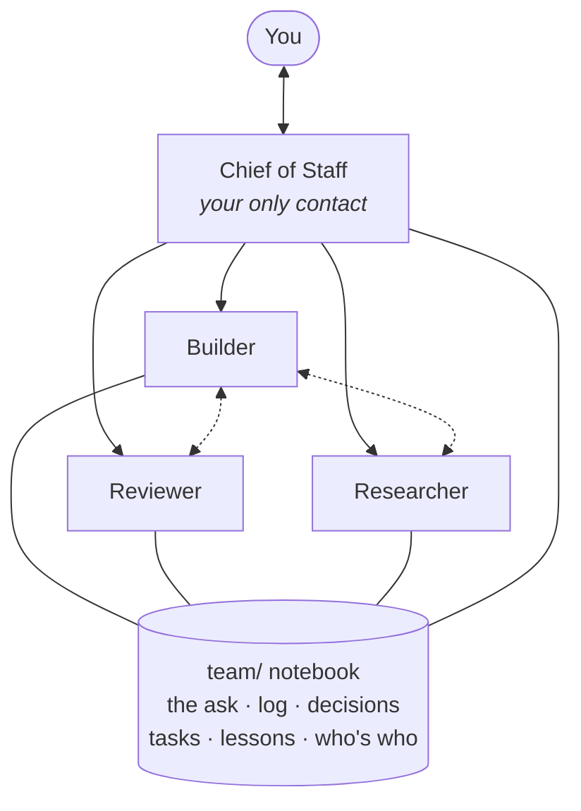

<div align="center">

# Assemble

**Run any project with a small team of named Claude chats.<br>You talk to one of them: your Chief of Staff.**


*The employee method, by Hriday Jain*

</div>

---

One Claude chat doing everything forgets what was decided, mixes jobs and repeats its mistakes.
Ten chats with no structure is worse. **assemble** sets up the structure: a Chief of Staff you
talk to, a few employee chats that each have one job, and one shared notebook that every chat
reads before it does anything. Your project ends up more detailed, more accurate and much
easier to manage.

Claude Code can now run a team of chats. **assemble is how they work together.**

## How it works



- **You only talk to the Chief.** The Chief thinks ideas through with you, gives you options
  with a recommendation, and brings you the research and the decisions only you can make.
- **The employees do the work.** Each has one job, a list of things it never does, and a
  place it is allowed to write. They can talk to each other to sort things out; anything
  that matters reaches the Chief.
- **The notebook is the memory.** Every chat reads it at the start of every session, so
  nobody needs the project explained twice and a mistake recorded once isn't made again.

## Get started

### 1. Install it: just ask Claude

Open Claude Code (terminal or desktop app) and paste this:

```text
Install the assemble skill for Claude Code from https://github.com/Hrixay/assemble.
Clone it with git (git clone --depth 1 https://github.com/Hrixay/assemble.git ~/.assemble-src),
then copy its skills/assemble folder to ~/.claude/skills/assemble, replacing any older copy.
If git isn't available, download the latest release's source zip instead. If a permission or
sandbox prompt appears, show me what it is and wait for my OK. Tell me when I can type /assemble.
```

<details>
<summary>Prefer to install by hand?</summary>

**Terminal:**

```bash
git clone --depth 1 https://github.com/Hrixay/assemble.git ~/.assemble-src
mkdir -p ~/.claude/skills && cp -R ~/.assemble-src/skills/assemble ~/.claude/skills/assemble
```

**Desktop app:** on the [Releases page](https://github.com/Hrixay/assemble/releases), download
the latest "Source code (zip)", unzip it, and copy its `skills/assemble` folder into
`~/.claude/skills/` (Mac: Finder → Go → Go to Folder… → `~/.claude/skills`; Windows:
`%USERPROFILE%\.claude\skills`).

If `/assemble` doesn't show up afterwards, restart Claude Code.

</details>

### 2. Run it in your project

Open Claude Code **in your project's folder**, or in an empty folder for a brand-new idea, and type:

```text
/assemble
```

### 3. Talk to your Chief

When setup is done, it tells you how to open your Chief of Staff. From then on, that's the
only chat you need. On the desktop app the Chief can start the rest of the team himself.

## What happens when you type `/assemble`

1. **It checks your setup** (git, GitHub login) before asking anything.
2. **It asks: new project or existing?**
3. **It gets to know the project.** For a new one, a few short questions about what you're
   making. For an existing one, a read-only look around the repo.
4. **It proposes a team** sized to the project, with three name ideas for each employee. You
   approve the team and pick the names.
5. **It shows you every file it will write.** Nothing is written until you say yes, and the
   setup itself arrives as a pull request.
6. **It hands you to your Chief.**

## Your team

| Team | Chats | Good for |
|---|---|---|
| **Small** | Chief + one doer (a fresh helper checks each change) | small projects, weekend ideas |
| **Standard** | Chief + doer + a Reviewer chat | most projects |
| **Full** | Standard + a Researcher, Designer, Editor, Analyst or a role of your own | big or research-heavy work |

The doer is whatever your project needs: a Builder for code, an Editor for writing, an Analyst
for data. Up to six chats. You can add or retire one later with `/assemble add` and
`/assemble retire`.

## The notebook

Everything lives in one `team/` folder:

| File | What it holds |
|---|---|
| `the-ask.md` | your original request, word for word, never edited |
| `README.md` | where things stand right now |
| `DECISIONS.md` | every decision, in your own words |
| `TASKS.md` | what's left, who's on what, and what's waiting on you |
| `LOG.md` | what happened, newest first |
| `LESSONS.md` | mistakes not to repeat |
| `ROSTER.md` · `CHATS.md` | who's who, and the rules every chat follows |
| `roles/` | one job description per chat |

It also adds a short block to your `CLAUDE.md` so every chat loads the rules, and a pull
request template. If your repo is live, public or shared, the notebook goes in a separate
private repo next to it instead, so a note can never trigger a deploy or be seen publicly.

See [`docs/example-lemonade/`](docs/example-lemonade/) for a fictional project with every file
filled in.

## The rules that make it work

| Rule | Why |
|---|---|
| You talk to the Chief only | one clear picture instead of five chats |
| Only you decide | chats propose; a decision exists only when you said yes |
| The notebook is the memory | chats forget; files don't |
| Every change is a pull request, checked by someone who didn't write it | you click Merge |
| The PR is the record, a message is only the doorbell | anything agreed is written down |
| Lessons are written down the same day | the same mistake isn't made twice |

## What you need

- **Claude Code**, in the terminal or the desktop app (the browser version isn't supported yet)
- **git**, and the **GitHub CLI** (`gh`) logged in with `gh auth login`
- A project on **github.com**, or an empty folder (it can create a private repo for you)

## Good to know

- **Usage:** each open chat uses your Claude plan. Small teams are the default for small
  projects, and you choose each chat's model on the approval screen.
- **Version 1.0 can't yet** set up a brand-new project that is already live, or add and
  retire employees on a team whose notebook lives in a separate repo. It says so and stops.
- **The desktop app route** is newer and less tested than the terminal. Issues and pull
  requests are welcome.
- **Updating:** `/assemble check` tells you when there's a new version. By hand in the
  terminal: `git -C ~/.assemble-src pull --ff-only`, then `rm -rf ~/.claude/skills/assemble`,
  then the second install line again.
- **Uninstalling:** delete `~/.claude/skills/assemble`. Your projects keep their `team/` folder.
- Unrelated projects with similar names exist (for example a `team-assemble` plugin, as of
  2026-10-12).

## Licence

- **The skill** is [MIT](LICENSE): use it, change it, share it, keeping the copyright notice.
- **The files it writes into your project** are yours (public domain under CC0 1.0): no
  attribution needed.
- Contributions come in under the same terms: see [CONTRIBUTING.md](CONTRIBUTING.md).

<div align="center">

*Built on Claude Code. The employee method, by Hriday Jain.*

</div>
